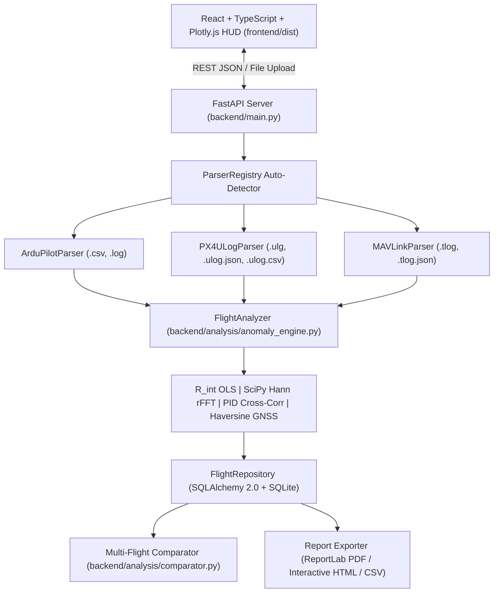

# AeroLens — Advanced UAV Flight Analytics & Intelligence Platform

[](https://www.python.org/)
[](https://fastapi.tiangolo.com/)
[](https://react.dev/)
[](https://plotly.com/javascript/)
[](./LICENSE)

**AeroLens (`aerolens-flight-analytics`)** is a production-grade post-flight UAV telemetry analysis platform. It ingests multi-ecosystem drone flight logs (**ArduPilot**, **PX4 ULog**, **MAVLink**), executes physics-based and statistical anomaly detection (electro-chemical battery $R_{\text{int}}$, SciPy FFT vibration spectra, PID phase lag & oscillation, GNSS Haversine glitch detection), scores overall flight health `0–100`, enables multi-flight comparison, and exports **ReportLab PDF**, **Interactive HTML**, and **CSV** engineering reports.

---

## System Architecture



Detailed mathematical derivations and schema contracts live in [`docs/ARCHITECTURE.md`](./docs/ARCHITECTURE.md).

---

## Core Engineering Capabilities

- **Modular Multi-Format Log Ingestion (`backend/parsers/`)**:
  - **ArduPilot**: DataFlash CSV exports and raw DataFlash text `.log` files (`FMT`, `ATT`, `BAT`, `VIBE`, `GPS`, `BARO`, `CTUN`, `MODE`, `MSG`).
  - **PX4 ULog**: Native binary `.ulg` decoder (`F`, `I`, `A`, `D`, `L` blocks), structured `.ulog.json` (with Hamilton quaternion-to-Euler transformation), and `.ulog.csv`.
  - **MAVLink**: Telemetry `.tlog.json` streams and binary `.tlog` wire packets (MAVLink v1 `0xFE` & v2 `0xFD` with zero-trimming recovery).
- **Physics & Statistical Anomaly Engine (`backend/analysis/anomaly_engine.py`)**:
  - **Battery Electro-Chemistry**: Decouples open-circuit discharge from ohmic drop via coupled OLS regression $V(t) = V_0 - k_{\text{soc}}Q(t) - R_{\text{int}}I(t)$, estimating pack internal resistance ($m\Omega$), $R^2$, IR-compensated $V_{\text{oc}}$, and under-load voltage sag windows.
  - **Spectral Vibration & Clipping**: Computes 3-axis & total RMS vibration, detects accelerometer clipping, and extracts dominant rotor/frame harmonic frequencies via Hann-windowed `scipy.fft.rfft`.
  - **Attitude PID Loop Diagnostics**: Evaluates desired-vs-actual RMS error, computes response lag (ms) via `scipy.signal.correlate`, and flags sustained PID oscillation windows with local spectral frequency isolation.
  - **GNSS Integrity**: Flags HDOP spikes, satellite constellation drops, and unphysical kinematic Haversine position jumps.
  - **Flight Health Score (0–100)**: Transparent equal-weight composite score across Power, Vibration, Attitude, and Navigation subsystems + chronological event timeline.
- **Multi-Flight Comparison (`backend/analysis/comparator.py`)**:
  - Normalizes flights onto a `0–100%` mission-progress grid, computes KPI deltas against a selected baseline flight, and generates comparative engineering insights.
- **Export Suite (`backend/exporters/report_exporter.py`)**:
  - **PDF Report**: ReportLab multi-section diagnostic PDF with vector telemetry `LinePlot` graphics, health scorecard, anomaly table, and mission timeline.
  - **Interactive HTML**: Self-contained dark-mode aerospace report with offline inline SVG + JavaScript hover plots.
  - **CSV Export**: Canonical + derived telemetry channels with `anomaly_active` flags.
- **Interactive Telemetry HUD (`frontend/`)**:
  - Synchronized Plotly.js charts, click-to-seek playback scrubber with live HUD readout, filterable anomaly inspector, drag-and-drop uploader, and multi-flight comparison workspace.

---

## Quickstart

### 1. Backend Setup & Launch
```bash
cd 01-AEROLENS
python -m venv .venv
# Windows: .venv\Scripts\activate  |  Linux/macOS: source .venv/bin/activate
pip install -r requirements.txt

# Optional: copy .env.example to .env
uvicorn backend.main:app --host 127.0.0.1 --port 8000
```
Open **`http://127.0.0.1:8000`** in your browser. On startup, AeroLens initializes SQLite (`aerolens.db`) and automatically seeds the 4 deterministic synthetic flights from `sample_data/` (when `AEROLENS_AUTO_SEED_SAMPLES=true`).

Interactive OpenAPI docs are available at **`http://127.0.0.1:8000/docs`**.

### 2. Frontend Development (Optional — pre-built `frontend/dist/` is included)
```bash
cd frontend
npm install
npm run dev     # Vite dev server at http://localhost:5173 (proxies /api -> 127.0.0.1:8000)
npm run build   # Rebuilds production bundle into frontend/dist/
```

---

## Synthetic Sample Flight Logs (`sample_data/`)

> **Note**: All files in `sample_data/` are **deterministic, physics-generated synthetic datasets** created by [`scripts/generate_sample_logs.py`](./scripts/generate_sample_logs.py) and are explicitly labeled as synthetic in file headers, API metadata, UI badges, and exported reports.

| File | Format | Injected Scenario | Typical Diagnostics |
|---|---|---|---|
| `synthetic_nominal_survey_flight.csv` | ArduPilot CSV | Healthy 4S survey flight (120 s @ 20 Hz) | Health `100/100 (NOMINAL)`, $R_{\text{int}} \approx 42\text{ m}\Omega$, 0 anomalies |
| `synthetic_voltage_sag_vibration_anomaly.csv` | ArduPilot CSV | Aged 4S pack + unbalanced rotor (45 s @ 200 Hz) | Elevated $R_{\text{int}} \approx 165\text{ m}\Omega$, deep sag, **78.0 Hz FFT peak**, 14 IMU clips (`CRITICAL`) |
| `synthetic_gps_glitch_attitude_instability.ulog.json` | PX4 ULog JSON | Mid-flight GNSS spoof/multipath + P-gain oscillation (80 s @ 25 Hz) | HDOP `4.9`, sats drop `14→5`, 42 m jump, **4.2 Hz PID oscillation** (`CRITICAL`) |
| `synthetic_mavlink_telemetry_sample.tlog.json` | MAVLink JSON | Mapping mission with wind gust & RTH battery sag (75 s @ 10 Hz) | Gust attitude excursions & RTH sag (`WARNING` / `CAUTION`) |

Regenerate sample data anytime with:
```bash
python scripts/generate_sample_logs.py
```

---

## REST API Reference

| Method | Endpoint | Description |
|---|---|---|
| `GET` | `/api/health` | Service health check, registered parsers, active UI source |
| `GET` | `/api/parsers` | List registered flight log parsers and extensions |
| `GET` | `/api/flights` | List all stored flights with health scores and summary metrics |
| `POST` | `/api/flights/upload` | Multipart upload (`file`, optional `name`, optional `format_hint`) |
| `POST` | `/api/flights/seed-samples` | Idempotently seed missing sample logs into SQLite |
| `GET` | `/api/flights/{id}` | Full flight details, FFT spectrum, anomalies, and event timeline |
| `GET` | `/api/flights/{id}/telemetry?max_points=2500` | Downsampled or full (`max_points=0`) telemetry records |
| `DELETE` | `/api/flights/{id}` | Delete flight and cascading anomalies/events |
| `POST` | `/api/flights/compare` | Compare 2–6 flights (`{"flight_ids": [1, 2], "n_points": 80}`) |
| `GET` | `/api/flights/{id}/export/pdf` | Download binary ReportLab PDF flight health report |
| `GET` | `/api/flights/{id}/export/html` | Download standalone interactive HTML flight report |
| `GET` | `/api/flights/{id}/export/csv` | Download RFC-4180 telemetry + anomaly flag CSV |

---

## Running Tests

```bash
python -m pytest tests -v
```

Test coverage spans:
- `tests/test_parsers.py`: ArduPilot CSV & `.log`, PX4 binary `.ulg` & `.ulog.json`, MAVLink binary `.tlog` & `.tlog.json`, quaternion conversion, and malformed input error handling.
- `tests/test_anomaly_engine.py`: Exact $R_{\text{int}}$ regression recovery, SciPy FFT dominant harmonic recovery, cross-correlation PID phase lag, Haversine GPS jump detection, and multi-flight comparison deltas.
- `tests/test_api_and_exports.py`: FastAPI `TestClient` lifecycle, auto-seeding, upload/compare/delete endpoints, ReportLab `%PDF-` signature validation, interactive HTML SVG output, and CSV export.

---

## License

Released under the [MIT License](./LICENSE).
