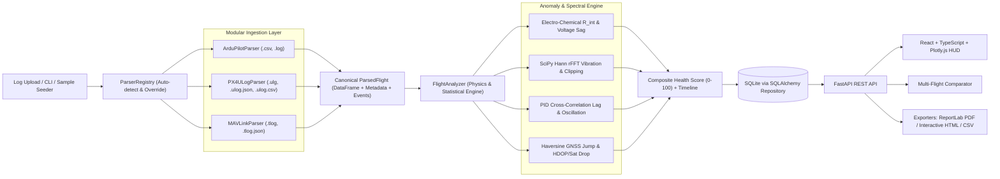

# AeroLens System Architecture

## 1. Overview

**AeroLens (`aerolens-flight-analytics`)** is a modular UAV flight log ingestion, physics-based diagnostic, multi-flight comparison, and engineering reporting platform built with **FastAPI**, **SQLAlchemy 2.0 / SQLite**, **NumPy / SciPy**, **ReportLab**, and **React 18 + TypeScript + Plotly.js**.

---

## 2. Canonical Telemetry Model

Every flight log—regardless of autopilot ecosystem—is normalized by `BaseFlightParser.finalize_dataframe()` into a sorted, zero-based time-series schema (`backend/parsers/base.py`):

| Channel | Unit | Description |
|---|---|---|
| `timestamp_s` | `s` | Monotonic elapsed mission time starting at `0.0` |
| `voltage_v`, `current_a`, `battery_remaining_pct` | `V`, `A`, `%` | Pack terminal voltage, load current, SoC |
| `roll_deg`, `pitch_deg`, `yaw_deg` | `deg` | Actual airframe Euler orientation |
| `roll_des_deg`, `pitch_des_deg`, `yaw_des_deg` | `deg` | Autopilot attitude loop setpoints |
| `vibe_x`, `vibe_y`, `vibe_z`, `clip_count` | `m/s²`, `count` | 3-axis accelerometer vibration & clipping counters |
| `gps_lat`, `gps_lon`, `gps_alt_m`, `gps_hdop`, `gps_nsats`, `gps_speed_ms` | `deg`, `m`, `HDOP`, `sats`, `m/s` | GNSS fix solution & dilution metrics |
| `baro_alt_m`, `throttle_pct`, `flight_mode` | `m`, `%`, `str` | Barometric/local altitude, motor throttle, mode label |

Heterogeneous asynchronous streams (such as binary `.ulg` topics or `.tlog` packet streams) are merged via `merge_topic_frames()` using nearest-timestamp alignment (`pandas.merge_asof`).

---

## 3. Physics & Statistical Anomaly Detectors

### 3.1 Electro-Chemical Internal Resistance ($R_{\text{int}}$) & Voltage Sag
Battery terminal voltage during flight obeys:

$$V(t) = V_0 - k_{\text{soc}}\, Q(t) - R_{\text{int}}\, I(t)$$

where $Q(t) = \frac{1}{3600}\int_0^t I(\tau)\,d\tau$ is cumulative Coulomb discharge (Ah). `FlightAnalyzer._analyze_power()` solves the overdetermined system via ordinary least squares (`numpy.linalg.lstsq`), decoupling open-circuit discharge droop from ohmic $I \cdot R_{\text{int}}$ drop and computing fit $R^2$ plus IR-compensated open-circuit voltage $V_{\text{oc,est}}(t) = V(t) + I(t)R_{\text{int}}$.

- **Pack Cell Inference**: Infers LiPo series cell count $S$ from early-flight peak voltage unless supplied by metadata.
- **Thresholds**:
  - `ELEVATED_RINT`: $R_{\text{int}} / S > 22\text{ m}\Omega/\text{cell}$ (warning) or $> 32\text{ m}\Omega/\text{cell}$ (critical).
  - `VOLTAGE_SAG`: Sustained ($> 0.4\text{ s}$) pack voltage $< 3.45\text{ V/cell}$ (warning) or $< 3.30\text{ V/cell}$ (critical).

### 3.2 Vibration RMS, Clipping & Spectral Peak (`scipy.fft.rfft`)
- Resamples the highest-energy vibration axis onto a uniform grid at `sample_rate_hz`, removes DC offset, applies a **Hann window** (`scipy.signal.windows.hann`), and computes single-sided amplitude via `scipy.fft.rfft` & `scipy.fft.rfftfreq`.
- Evaluates sustained vibration windows over a **0.5 s rolling RMS envelope** so high-frequency AC oscillations (e.g., 78 Hz unbalanced rotor harmonics) are accurately captured instead of dropping out at zero crossings.
- Flags `HIGH_VIBRATION` when rolling axis RMS $> 25\text{ m/s}^2$ or total vector RMS $> 32\text{ m/s}^2$, and `IMU_CLIPPING` on any positive delta in accelerometer clip counters.

### 3.3 Attitude PID Tracking Lag & Oscillation Detection
- Computes `roll_err = roll_des - roll` and `pitch_err = pitch_des - pitch`.
- **Phase Lag**: Computes normalized cross-correlation via `scipy.signal.correlate` and `scipy.signal.correlation_lags` within $[-0.25\text{ s}, +0.80\text{ s}]$ to measure loop response latency in milliseconds.
- **Oscillation Detection**: Evaluates a 0.8 s rolling RMS error envelope; windows exceeding $2.8^\circ$ RMS trigger `PID_OSCILLATION` or `ATTITUDE_TRACKING_LAG` with local spectral peak isolation in $[1.2\text{ Hz}, 18\text{ Hz}]$.

### 3.4 GNSS Integrity & Kinematic Position Jump Detection
- Flags `GPS_HDOP_SPIKE` ($> 2.0$ warning, $> 3.5$ critical) and `GPS_SAT_DROP` ($< 8$ warning, $< 6$ critical).
- Computes consecutive **Haversine** ground displacement $\Delta d$ and implied speed $\Delta d / \Delta t$; unphysical jumps ($\Delta d > 8\text{ m}$ with implied speed $> 45\text{ m/s}$ or $> 12\text{ m}$ within $\le 1.2\text{ s}$) emit `GPS_POSITION_JUMP`.

### 3.5 Composite Flight Health Score (0–100)
Weighted equally (25% each) across **Power**, **Vibration**, **Attitude**, and **Navigation** sub-scores, producing letter grades `A`–`F` and operational status (`NOMINAL`, `CAUTION`, `CRITICAL`).

---

## 4. Persistence & Multi-Flight Comparison
- **SQLAlchemy 2.0 + SQLite** (`backend/database.py`, `backend/models.py`) stores `FlightRecord`, `FlightAnomalyRecord`, and `FlightEventRecord` with cascade delete integrity via `FlightRepository`.
- **Multi-Flight Comparator** (`backend/analysis/comparator.py`) resamples each flight onto a normalized $0\text{–}100\%$ mission-progress grid and computes baseline KPI deltas and automated diagnostic insights.

---

## 5. Exporters
- **ReportLab PDF (`export_pdf_report`)**: Multi-section aerospace PDF with executive scorecard, physics KPI table, embedded vector `LinePlot` telemetry charts, anomaly findings table, and mission timeline.
- **Standalone Interactive HTML (`export_html_report`)**: Self-contained dark-mode engineering report with offline inline SVG + JavaScript interactive hover plots.
- **CSV (`export_csv_report`)**: RFC-4180 CSV containing metadata comment headers, canonical + derived series, and `anomaly_active` flags.
